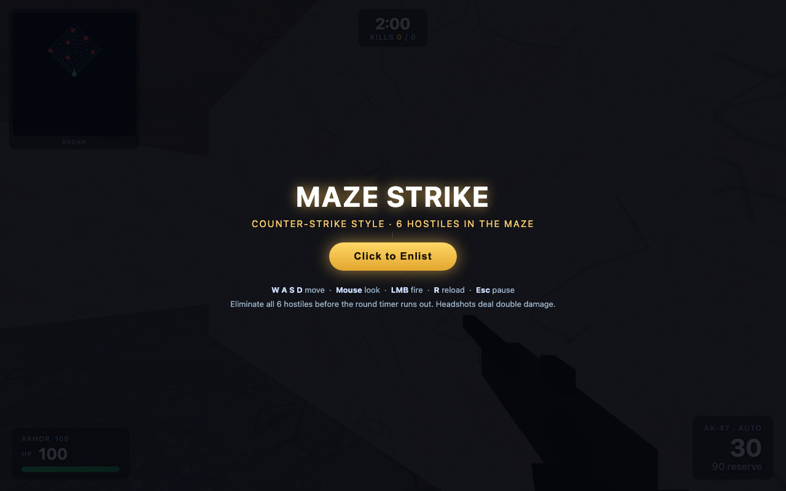

# dsh-turbo

Best-of-N sampling with an **LLM-as-a-Verifier** judge for [DeepSeek Harness](https://www.npmjs.com/package/@deepseek-ai/dsh) — as one ordinary model route.

Pick the `deepseek-turbo` provider in your model selector and every model call samples **N candidates in parallel**, scores them with **fine-grained logprob verification**, and hands your agent the **tournament winner**. Faithful implementation of [LLM-as-a-Verifier](https://scalingintelligence.stanford.edu/pubs/llm_as_a_verifier/) (Stanford Scaling Intelligence Lab): sampling 5 candidates with DeepSeek and ranking them with the same model lifted Terminal-Bench accuracy from 79% to 88% in the paper — outperforming closed frontier models at a fraction of the cost.

## Install

```bash
dsh plugin add dsh-turbo
```

That's it if you already use the official DeepSeek route: dsh-turbo reads the **same `DEEPSEEK_API_KEY` credential** (credentials service first, environment second). Otherwise:

```bash
export DEEPSEEK_API_KEY=sk-...
```

Restart `dsh`, open the model selector, choose **DeepSeek Turbo → DeepSeek-V4-Flash-Vision-Exp (Turbo)**. Done — no other configuration exists between you and best-of-5.

Default models, in order:

| Model | Input | Notes |
|---|---|---|
| `deepseek-v4-flash-vision-exp` | text + images | default; DeepSeek's multimodal model |
| `deepseek-v4-flash` | text | |
| `deepseek-v4-pro` | text | |

Images flow end to end: candidates receive them as real multimodal input, and the verifier sees the same pixels when judging.

## How it works

Every conversation model call (auxiliary calls like compaction/session titles pass straight through):

1. **Sample** — N=5 parallel generations against the DeepSeek API, spread over a temperature ladder.
2. **Verify** — pairwise comparative prompts on a 20-point scale anchored on *how likely the candidate actually solved the task*, requested with `logprobs: true, top_logprobs: 20`. The reward is the **expectation over the score token's probability distribution**, not the argmax — the paper's key signal (one logprob evaluation ≈ 16 discrete-judge votes) — normalized to [0, 1]. Scores decompose over three criteria (specification adherence / output match / error signals), each seeing the same standing ground-truth note, and can repeat K times.
3. **Select** — a **Probabilistic Pivot Tournament**: one ring pass over a random circuit (each candidate judged once as A and once as B, cancelling slot bias), top ring scorers become pivots, everyone else is compared against the pivots, and Bradley-Terry preferences aggregate into a **mean** preference per candidate. Sub-quadratic in N.
4. **Replay** — the winner's stream chunks replay to the agent loop, which sees one ordinary model call. The winner's own token usage is reported (so context accounting stays correct); the extra spend of losing candidates and verifier calls is tracked separately.

Verifier prompts share a byte-identical prefix (system + note + task context) across every pair of a step, and the candidate-pair message is byte-identical across that pair's criterion calls, so DeepSeek prefix caching absorbs most of the verification input cost.

### Fidelity to the reference implementation

The scoring and selection follow [llm_verifier](https://github.com/llm-as-a-verifier/llm-as-a-verifier) v0.2.0 (2026-08-14), including the details its own issue history produced: the score distribution is read at the **last** `<score_A>` occurrence (a model that quotes the output format mid-analysis must not shadow its verdict), whitespace-only tokens are skipped when locating the tag, a fused `>` prefix is stripped from score tokens, and an unreadable evaluation contributes a neutral 0.5 rather than dropping out and silently re-weighting the rest.

Two deliberate differences:

- **Integers 1–20 instead of letters A–T.** Upstream uses letters because a single letter is one token on every backend. Probing the live DeepSeek API, the score position offered **18/20 legal integer alternatives versus 5/20 legal letter alternatives** — DeepSeek fuses the closing `>` into the letter token, so most alternatives there are unusable. On this provider integers carry more of the distribution the method depends on.
- **A run where nothing scored is reported as degraded.** Defaulting an unreadable evaluation to neutral is upstream's behaviour, but taken to its limit it hides a total verification outage behind a tie-broken pick. `/turbo` and the decision log report `usableEvaluations`, and a run with none is marked degraded instead of presented as a ranking.

## Example: one image in, a playable 3D game out

[`examples/vision-3d-game`](examples/vision-3d-game) is the full end-to-end run
on a stock DSH install — a maze image pasted into the composer, and the agent
builds a first-person 3D dungeon crawler from what it saw, then converts it into
a Counter-Strike style FPS in a follow-up turn. Both games were written entirely
by the model; open them in a browser and play.



Across those two turns: 25 fan-out steps, 5 candidates each, **zero degraded**,
740 verifier calls, 19 M cached prompt tokens.


## The `/turbo` command

- `/turbo` — last decision (per-candidate mean preference, pivots, pair count, previews), how many evaluations fell back to neutral, and cumulative extra spend.
- `/turbo off` / `/turbo on` — temporarily pass single calls through without switching models.

Decision records also append to `$DSH_HOME/dsh-turbo/decisions.jsonl` for offline analysis.

## Configuration (optional)

Everything lives in the `dsh-turbo:` section of `$DSH_HOME/settings.yaml` (hot-reloaded):

```yaml
dsh-turbo:
  n: 5                  # candidates per call; 1 = plain passthrough
  repeats: 1            # K verifier repeats per pair and criterion
  pivots: 2             # ring leaders anchoring the comparison round
  criteria: coding      # coding | general
  temperatures: [0.2, 0.5, 0.8, 1.0, 1.2]
  verifierModel: deepseek-v4-flash-vision-exp   # default: the candidate model
  verifierTemperature: 1
  verifierMaxTokens: 2000
  apiKeyEnv: DEEPSEEK_API_KEY
  baseURL: https://api.deepseek.com   # any OpenAI-compatible endpoint that returns logprobs (vLLM!)
  decisionLog: true
```

Pointing `baseURL` at a vLLM (or any OpenAI-compatible, logprob-returning) server gives your self-hosted models the same best-of-N treatment.

## Cost and latency

Best-of-N is a deliberate trade: with defaults, one step costs ~5 candidate generations plus ~36 short verifier calls (most of whose input is prefix-cache hits). Responses arrive after all candidates and verification complete — the status line shows sampling/verifying progress while you wait. Budget option: `n: 3, pivots: 1` roughly halves the extra spend.

## Notes

- A candidate that fails (transport error, empty response) is dropped; survivors still compete. If **verification** itself fails, the first surviving candidate is used and the decision is recorded — and reported — as degraded.
- `/turbo` and the status line appear only on surfaces that provide the commands / TUI status services; everything else works headless.

## License

MIT
