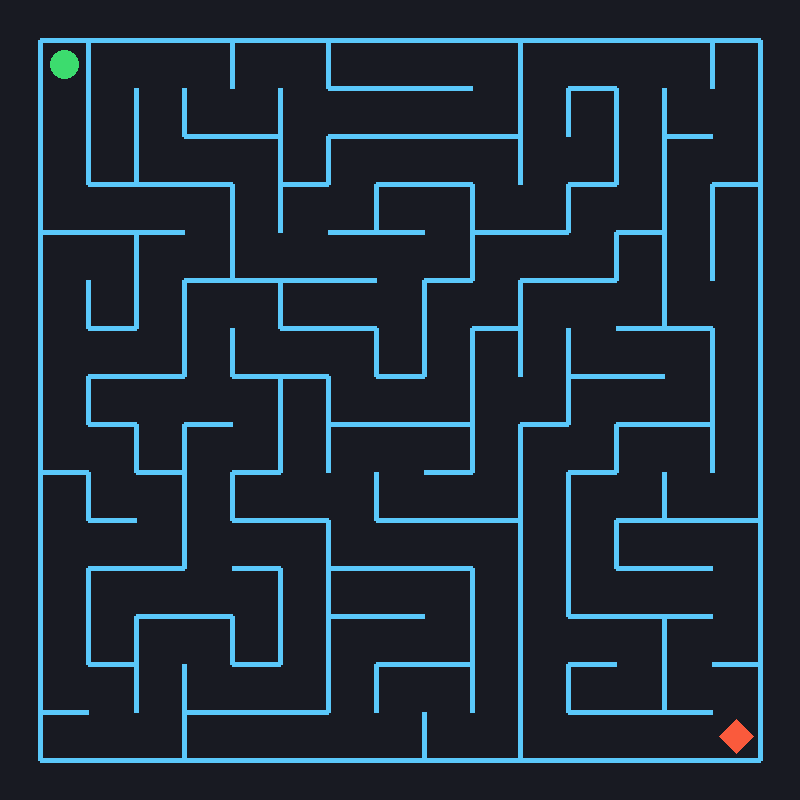
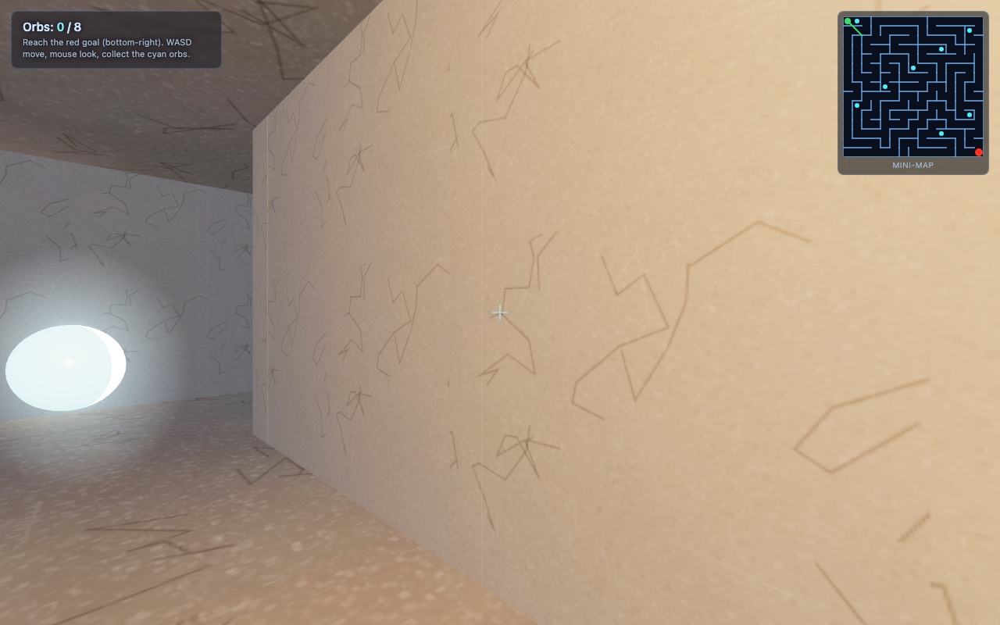
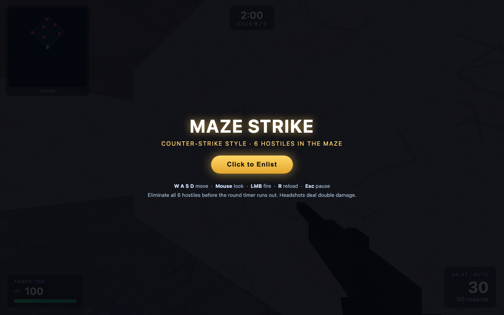

# DSH community post — "Show Your Plugins!"

**Category**: Show Your Plugins!
**Title**: dsh-turbo — best-of-N with an LLM-as-a-Verifier judge, as one model route

**Attach**: `assets/seed-maze.png`, `assets/01-dungeon-crawler.png`, `assets/02-maze-strike.png`

---

[dsh-turbo](https://github.com/weijiafu14/dsh-turbo) (npm: `dsh-turbo`) makes test-time scaling something you turn on by picking a model.

Install the plugin, pick the **DeepSeek Turbo** provider, and every model call in your session fans out into 5 parallel candidates, gets ranked by a fine-grained verifier, and the winner streams back. The agent loop sees one ordinary model call — tools, session log, context accounting all unchanged.

```sh
dsh plugin add dsh-turbo
export DEEPSEEK_API_KEY=sk-...        # the same credential the official DeepSeek route uses
```

Restart dsh, open the model selector, choose **DeepSeek Turbo → DeepSeek-V4-Flash-Vision-Exp (Turbo)**. That is the entire setup — there is no second configuration surface.

## What it implements

It is a faithful implementation of [LLM-as-a-Verifier](https://scalingintelligence.stanford.edu/pubs/llm_as_a_verifier/) (Stanford Scaling Intelligence Lab, arXiv 2607.05391), not a "sample N and ask a judge to pick" approximation:

- **Fine-grained scoring via logprobs.** The verifier scores candidate pairs on a 1–20 scale, requested with `logprobs: true, top_logprobs: 20`. The reward is the *expectation over the score token's probability distribution*, not the argmax. The paper's ablation is the reason this matters: one logprob evaluation carries about as much signal as 16 discrete-judge votes.
- **Criteria decomposition.** Each pair is scored separately on specification adherence, output match, and error signals, then averaged.
- **Probabilistic Pivot Tournament.** A ring pass over a random circuit (every candidate appears once as A and once as B, cancelling position bias), pivots chosen by ring score, then a comparison round, with Bradley-Terry preference probabilities accumulated into win totals. Sub-quadratic in N.

Everything runs against DeepSeek's official API over the plugin's own transport, so candidates and verification share one client and one credential. Point `baseURL` at a vLLM server and your self-hosted models get the same treatment — any OpenAI-compatible endpoint that returns logprobs works.

## An end-to-end run

I pasted this maze image into the composer and asked for a first-person 3D game — the prompt never says the word "maze", only the pixels do:



The reply opened with `IMAGE SHOWS: a rectangular 2D orthographic maze drawn with blue walls on a dark background, with a green circle marker at the top-left corner (start) and a red diamond marker at the bottom-right corner (goal)`, and the agent then wrote a 26 KB three.js dungeon crawler — pointer-lock first person, procedural stone textures, torch lights, fog, collectible orbs, a working mini-map, win screen:



A follow-up turn in the same session converted it into a Counter-Strike style FPS in a new file (56 KB): rifle viewmodel with recoil, hitscan fire, bullet decals, magazine and reload, six patrolling bots with line-of-sight chase, kill feed, radar, round timer, scoreboard.



Both files were written entirely by the model — I did not edit or fix a line. Both are in the repo under [`examples/vision-3d-game`](https://github.com/weijiafu14/dsh-turbo/tree/main/examples/vision-3d-game), playable in a browser, with the verbatim prompts.

Across those two turns:

| | Turn 1 | Turn 2 |
|---|---|---|
| Fan-out steps | 7 | 18 |
| Candidates per step | 5 | 5 |
| Degraded steps (verification failed) | 0 | 0 |
| Verifier calls | 211 | 529 |
| Cached prompt tokens | 1.87 M | 17.2 M |

Those cache numbers are the reason this is affordable. Verifier prompts are layered so that the task context and the candidate pair stay byte-identical across a pair's three criterion calls — the candidates are often whole generated files, and they are billed as cache hits after the first call.

## Seeing what it did

`/turbo` prints the last decision: per-candidate previews, Bradley-Terry win totals, which candidates were pivots, and the cumulative extra spend. `/turbo off` passes single calls through without switching models. Every decision also appends to `$DSH_HOME/dsh-turbo/decisions.jsonl`.

The winner's own token usage is what streams back, so context accounting and compaction stay correct; the extra spend of losing candidates and verifier calls is reported separately rather than folded in.

## Honest scope

- **What I verified**: the method is implemented as described, the route works end to end on a stock `@deepseek-ai/dsh@0.1.1-rc.2` install (CLI mount + web, real API, images included), candidate failures degrade gracefully, and `pnpm verify` covers the scoring, tournament, serialization, and adapter contracts.
- **What I have not verified**: the accuracy numbers in the paper (Terminal-Bench 79% → 88%) are *theirs*, measured on their harness. I have not run a controlled benchmark of dsh-turbo against single-shot DeepSeek, so treat the quality lift as the paper's claim, not mine. A same-prompt A/B is the obvious next step.
- **The trade**: with defaults a step costs ~5 generations plus ~36 short verifier calls, and the reply arrives only after verification, so it is slower per turn. `n: 3, pivots: 1` roughly halves that.

Issues and PRs welcome — especially A/B data if anyone runs some.
