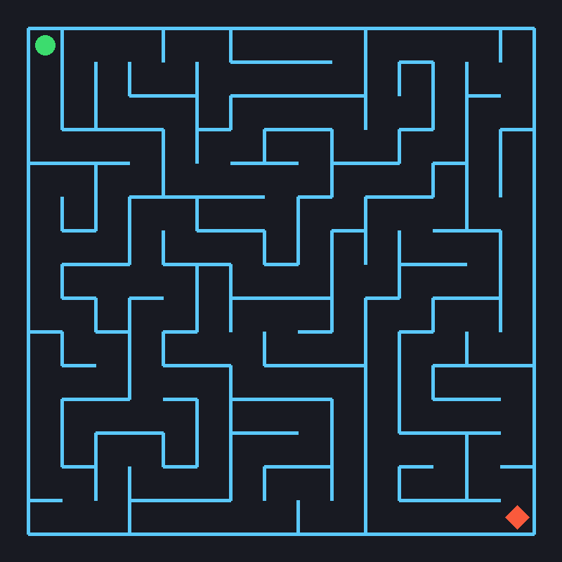
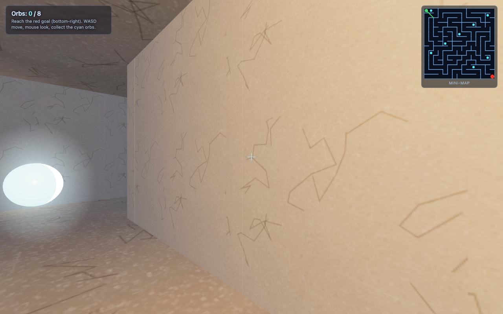
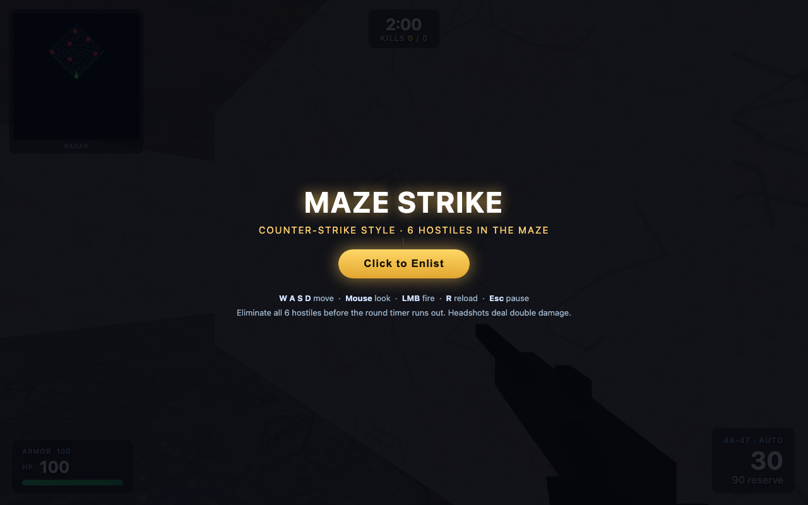

# Example: one image in, a playable 3D game out

This example is the end-to-end run that proves the whole `dsh-turbo` path on a
stock DeepSeek Harness install: an image goes into the composer, every model
call fans out into 5 candidates that a logprob verifier ranks, and the agent
builds a playable 3D browser game from what it saw in the pixels.

Both games in this folder were written **entirely by the model** inside a real
DSH session. Nothing here was hand-edited afterwards.

| | |
|---|---|
|  |  |
| The image pasted into the composer | What came back: a first-person dungeon crawler |

## What you need

- A DeepSeek API key with access to `deepseek-v4-flash-vision-exp`
- A DSH install (`@deepseek-ai/dsh@0.1.0-rc.8` or `0.1.1-rc.x`)

## Step 1 — install the engine

```sh
dsh plugin --profile web add dsh-turbo
export DEEPSEEK_API_KEY=sk-...
```

The same credential the official DeepSeek route uses. If you already run DSH
against DeepSeek, you are done configuring.

## Step 2 — select the turbo route

Restart `dsh`, open the model selector, and pick
**DeepSeek Turbo → DeepSeek-V4-Flash-Vision-Exp (Turbo)**.

Or set it as the default in `$DSH_HOME/settings.yaml`:

```yaml
agent-default-model:
  provider: deepseek-turbo
  model: deepseek-v4-flash-vision-exp
```

## Step 3 — paste the image and ask

Start `dsh web`, open a workspace, paste [`assets/seed-maze.png`](assets/seed-maze.png)
into the composer, and send this prompt — note that it never says what the
image contains:

```text
Look carefully at the attached image. First reply with one line beginning
"IMAGE SHOWS:" describing exactly what kind of structure it depicts. Then build
a FIRST-PERSON 3D exploration game whose level layout faithfully reproduces that
structure: one single self-contained HTML file named game3d.html in the
workspace root, using three.js (CDN <script> is fine). Requirements for a rich
interior environment: the player walks INSIDE the corridors in first person
(pointer-lock mouse look + WASD, collision with walls); stone-textured walls
(procedural canvas textures), floor and ceiling; flickering torch point-lights
along the corridors plus fog and ambient light; a few collectible glowing orbs
that update a HUD counter; a mini-map overlay in a corner showing the layout and
player position; the green marker from the image is the spawn point and the red
marker is the goal — reaching it shows a win screen.
```

The reply opens with the proof that vision reached the model:

> IMAGE SHOWS: a rectangular 2D orthographic maze drawn with blue walls on a dark
> background, with a green circle marker at the top-left corner (start) and a red
> diamond marker at the bottom-right corner (goal).

and the agent then writes [`game3d.html`](game3d.html) — 26 KB, three.js,
pointer-lock first person, procedural stone textures, torch lights, fog,
8 collectible orbs, a working mini-map, and a win screen. Open it in a browser
and play it.

## Step 4 — push it further (optional)

In the same conversation, ask for a Counter-Strike style conversion in a new
file. [`game_cs.html`](game_cs.html) is what came back — 56 KB, with a rifle
viewmodel, recoil, hitscan fire, bullet decals, magazine + reload, 6 patrolling
enemy bots with line-of-sight chase, a kill feed, radar, round timer and
scoreboard:



Serve it over http (pointer lock is refused on `file://` in some browsers):

```sh
python3 -m http.server 8099 --bind 127.0.0.1
```

then open `http://127.0.0.1:8099/game_cs.html`.

## What the verifier was doing

Every model call in both turns fanned out into 5 candidates ranked by the
tournament. Run `/turbo` in the session to see the last decision, or read
`$DSH_HOME/dsh-turbo/decisions.jsonl`:

| | Turn 1 (dungeon crawler) | Turn 2 (CS conversion) |
|---|---|---|
| Fan-out steps | 7 | 18 |
| Candidates per step | 5 | 5 |
| Degraded steps (verification failed) | 0 | 0 |
| Verifier calls | 211 | 529 |
| Cached prompt tokens | 1.87 M | 17.2 M |
| Result | 26 KB | 56 KB |

The cache numbers matter: verifier prompts are layered so the task context and
the candidate pair stay byte-identical across a pair's criterion calls, so the
candidates — often whole generated files — are billed as cache hits.

## Reproducing the whole thing automatically

```sh
DEEPSEEK_API_KEY=sk-... node scripts/verify-vision-game-e2e.mjs
```

That script installs a stock DSH CLI into a temporary home, adds `dsh-turbo`
from a fresh `pnpm pack`, starts `dsh web`, drives a real browser to paste the
image and send the prompt, then asserts: the image became a native attachment,
the reply identifies the maze (which only the pixels could tell it), a three.js
game file landed in the workspace, and `decisions.jsonl` contains non-degraded
multi-candidate tournament decisions.
